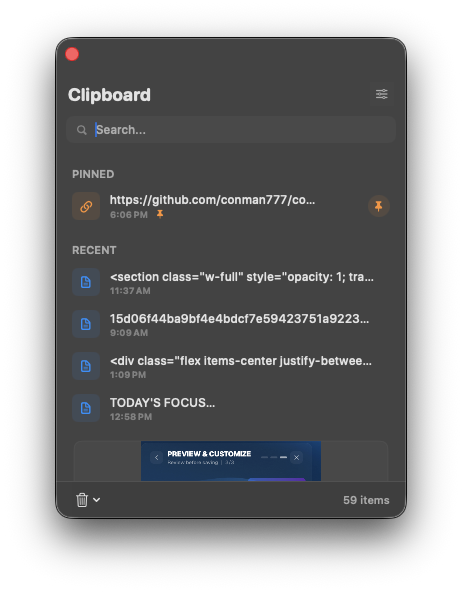
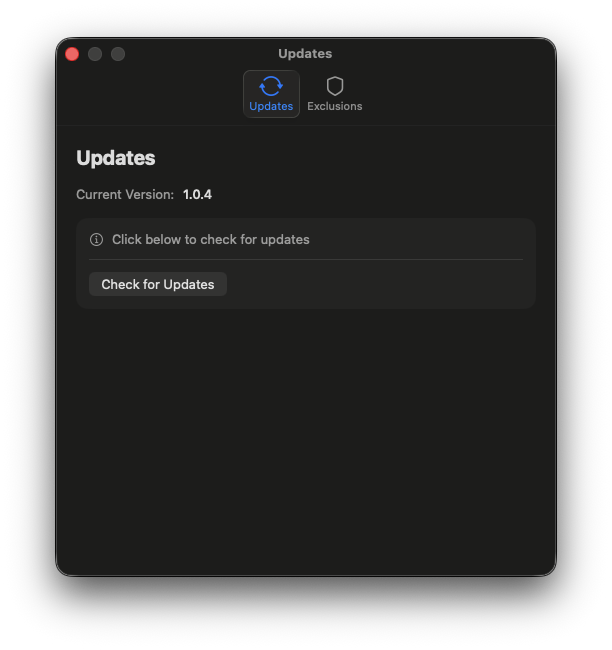

# ClipboardManager

<p align="center">
  
  <br>
  A modern, high-performance clipboard manager for macOS that prioritizes speed and visual clarity.
</p>


## Key Features

### 🖼️ High-Visibility Previews
Copy images or take screenshots and see them instantly. Unlike other managers that show generic icons, ClipboardManager provides large, clear previews so you know exactly what you're pasting.

<p align="center">
  
</p>

### ⚡ Quick HUD Picker (Option+V)
Press `Option+V` to open a Spotlight-style quick picker directly at your cursor. It's designed for speed, allowing you to use number keys (1-9) or arrow keys to instantly paste from your recent history.

### 🔍 Instant Search & Pinning
Filter through hundreds of items instantly with the built-in search. Keep your most important snippets—like code blocks, terminal commands, or email templates—at the top by pinning them.

### 🛡️ Privacy & Exclusions
Automatically ignore data copied from sensitive apps like 1Password, Bitwarden, or Keychain. You can easily add any app to the exclusion list in Settings.

<p align="center">
  
</p>

### 🚀 Smart Auto-Updates
Never worry about being out of date. The app monitors for new releases and can download and install them with a single click from the Settings menu.

---

## Keyboard Shortcuts

| Shortcut | Action |
|----------|--------|
| `Option+V` | Show quick HUD picker near cursor |
| `Cmd+Option+1-9` | Quick paste items 1-9 from history |
| `Cmd+Shift+K` | Clear all history |
| `Cmd+,` | Open Settings |

## Installation

### Download
Download the latest version from [GitHub Releases](https://github.com/conman777/copynoteapple/releases).

### Build from Source

```bash
# Clone and build
git clone https://github.com/conman777/copynoteapple.git
cd copynoteapple
./build-app.sh --open
```

## Privacy & Permissions

The app requires **Accessibility Permissions** to detect the global `Option+V` shortcut. Your clipboard data is stored **only locally** on your macOS user defaults and is never transmitted over the network.

## License

MIT
