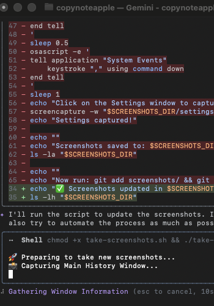
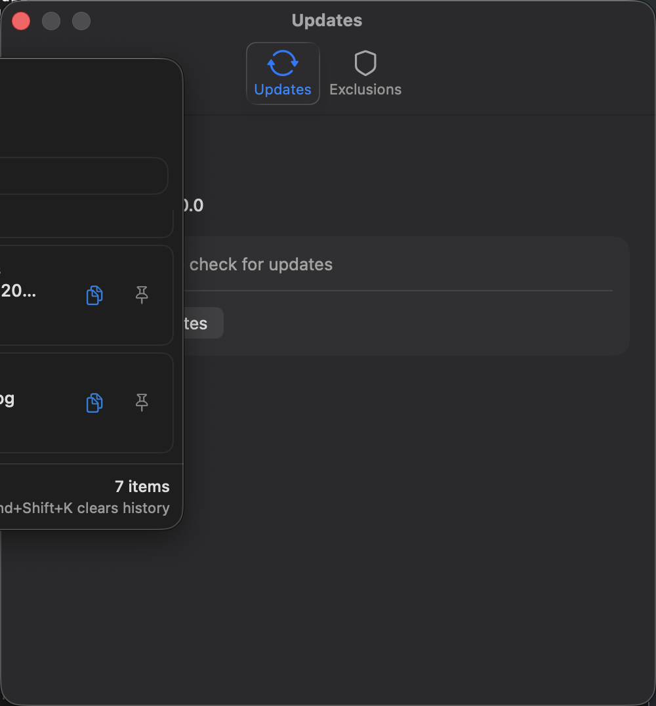

# ClipboardManager

A modern, high-performance clipboard manager for macOS that prioritizes speed and visual clarity.


## Screenshots

<p align="center">
  
  <br>
  <em>The main history view with large screenshot previews and search.</em>
</p>

<p align="center">
  
  <br>
  <em>Settings view with auto-update and exclusion lists.</em>
</p>

## What's New in v1.0.4 🚀

- **Redesigned Modern UI** - A polished, compact aesthetic with glassmorphism and smooth animations.
- **High-Visibility Previews** - Copy images or take screenshots and see them instantly with large, clear previews.
- **Smart Auto-Updates** - The app now downloads and installs updates automatically directly from Settings.
- **Performance Optimized** - Information-dense layout lets you see more history at a glance.

## Features

- **Clipboard History** - Automatically tracks text, URLs, and images.
- **Large Previews** - Visual content like screenshots are displayed clearly, not just as generic icons.
- **Quick HUD Picker** - Press `Option+V` to open a Spotlight-style quick picker at your cursor.
- **Privacy First** - **App Exclusions** prevent sensitive data (like from password managers) from being saved.
- **Native Experience** - Built entirely in Swift/SwiftUI for minimal resource usage and a native macOS feel.
- **Search & Pin** - Instant filtering and the ability to keep important snippets pinned at the top.
- **Persistent & Local** - Your history stays on your machine, saved across restarts.

## Keyboard Shortcuts

| Shortcut | Action |
|----------|--------|
| `Option+V` | Show quick HUD picker near cursor |
| `Cmd+Option+1-9` | Quick paste items 1-9 from history |
| `Cmd+Shift+K` | Clear all history |
| `Cmd+,` | Open Settings |

## Installation

### Download
Download the latest version from [GitHub Releases](https://github.com/conman777/copynoteapple/releases).

### Build from Source

**Requirements:**
- macOS 13 or later
- Swift 5.9+

```bash
# Clone the repo
git clone https://github.com/conman777/copynoteapple.git
cd copynoteapple

# Build and launch immediately
./build-app.sh --open
```

## Usage

1. **Launch the app** - It lives in your menu bar (look for the clipboard icon).
2. **Copy items** - Just use `Cmd+C` as usual; the app handles the rest.
3. **Quick Paste** - Press `Option+V` to see your last 15 items and press `Enter` or a number key to paste.
4. **Manage History** - Open the main window to search, pin, or delete items.

## Privacy & Permissions

The app requires **Accessibility Permissions** to detect the global `Option+V` shortcut. Your clipboard data is stored **only locally** in your macOS user defaults and is never transmitted anywhere.

## Project Structure

- **App.swift** - The core logic, UI views, and state management.
- **build-app.sh** - Creates a proper `.app` bundle for macOS.
- **Info.plist** - Application metadata and permissions.

## License

MIT